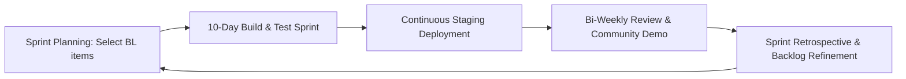

---
doc_id: D14
title: Agile UX Refinement Backlog and Version 2 Roadmap
file: AGILE_UX_REFINEMENT_BACKLOG.md
version: 1.0.0
status: Baselined
author: Amr Suleiman (Product & Technical Lead)
reviewer: Lead Software Engineer / Auditor
approved_by: Amr Suleiman & GDGOC ABU Zaria Core Team
approved_on: 2026-11-02
depends_on: [D00@1.0.0, D01@1.0.0, D03@1.0.0, D05@1.0.0, D07@1.0.0, D13@1.0.0]
---

# D14 Agile UX Refinement Backlog and Version 2 Roadmap

Nov 2, 2026 · @Amr Suleiman & Core Engineering Team

## 1. Document control and gate governance

D14 governs post-production iteration, user experience refinement, and the backlog of parked version 2 features for Campusly. 

| Field | Value |
| --- | --- |
| Document | D14 Agile UX Refinement Backlog |
| Version | 1.0.0 (Baselined) |
| Phase and gate | Post-Launch; unlocks strictly after Gate G6 and Gate G7 |
| Inputs | D00 to D13 (feedback, minor audit findings, and parked PRD ideas) |
| Feeds | Post-launch sprint planning and version 2 architecture |

### The Gate Rule for D14

- **GATE-G7-LOCK**: This document is locked during the Version 1 build. No feature from D14 may be introduced into the Version 1 prompt sequence (`PROMPT_SEQUENCE.md`) or codebase until Gate G6 (Production Release) has passed and Campusly is live in production.
- **Scope Discipline**: Ideas, feature requests, and UX enhancements discovered during building or audits that are not required for v1 MVP are assigned a `BL-###` identifier and parked here.

---

## 2. Post-launch sprint cadence and operating rhythm

Following production go-live, development transitions from Waterfall gates to a rapid **2-Week Agile Sprint Cadence**:

- **Sprint Planning (Monday Week 1)**: The product lead and engineers select and commit to backlog items (`BL-xxx`) prioritized by student value and revenue impact.
- **Continuous Staging Delivery**: Features are merged to `main` via PRs and verified continuously on the staging environment.
- **Bi-Weekly Demo & Review**: Demonstration of shipped enhancements to the GDGOC ABU Zaria executive team.
- **Retrospective**: Review of sprint velocity, bug leakage, and server performance metrics.

---

## 3. UX feedback intake and channel architecture

User feedback enters the product lifecycle through four structured channels:

| Channel | Mechanism | Handling SLA | Routing |
| --- | --- | --- | --- |
| **In-App Listing Reports** | Public "Report this listing" button on every profile. | Checked daily by admins. | If systemic (e.g. broken link flow), logged as a bug or UX refinement. |
| **Conversion Telemetry** | Privacy-respecting analytics events: Join taps, Apply clicks, search zero-results. | Reviewed weekly. | Drop-off points generate UX optimization tasks. |
| **Community Leader Town Halls** | Monthly physical/virtual meetups with ABU club executives. | Monthly review. | Feedback on submission and profile tools prioritized into sprint planning. |
| **Public Feedback Form** | Minimal in-app feedback link in footer ("Help improve Campusly"). | Reviewed bi-weekly. | Feature requests triaged into the `BL-###` backlog. |

---

## 4. Prioritized backlog register (`BL-001` to `BL-025`)

### Track 1: UX Refinements & Micro-Interactions (Immediate Post-v1)

| ID | Title | Description | Size | Priority |
| --- | --- | --- | --- | --- |
| **BL-001** | Device-Local Bookmarks | Allow students to save/bookmark favorite communities and events locally on their phone using IndexedDB. No login required. | Small | High |
| **BL-002** | Interactive Discovery Quiz | Expand the "I want to..." chips into a 3-question guided quiz recommending top 3 matching campus clubs. | Medium | High |
| **BL-003** | Fluid Gesture Transitions | Add iOS/Android native-feeling sheet pull-downs, spring physics, and swipe-to-back navigation for mobile PWA users. | Medium | Medium |
| **BL-004** | System Dark Mode Polish | Refined dark theme toggle respecting OS preference with manual override and high-contrast OLED black options. | Small | Medium |
| **BL-005** | Faceted Multi-Tag Search | Multi-select filters allowing combinations (e.g. Faculty of Engineering + Technology + Weekend Meeting). | Medium | Medium |

### Track 2: Student Authentication & Identity (Version 2 Core)

| ID | Title | Description | Size | Priority |
| --- | --- | --- | --- | --- |
| **BL-006** | ABU Student Email Authentication | Implement student accounts verified via official institutional emails (`@abu.edu.ng` or `@student.abu.edu.ng`). | Large | High |
| **BL-007** | Authenticated Upvoting (Verified Stars) | Transition Spotlight stars from device tokens to verified student votes, eliminating vote gaming entirely. | Medium | High |
| **BL-008** | Student Activity Dashboard | Logged-in students can view communities they have joined, active applications, and saved calendar events. | Large | Medium |
| **BL-009** | Community Executive Portal | Club leaders can edit their active community profiles, add new officers, and post community updates directly. | Large | High |
| **BL-010** | WhatsApp Event Reminders | Opt-in student notification service sending an automated WhatsApp ping 2 hours before a saved event begins. | Medium | Medium |

### Track 3: Commercial & Payment Automation

| ID | Title | Description | Size | Priority |
| --- | --- | --- | --- | --- |
| **BL-011** | Paystack / Flutterwave Gateway | Direct integration with Nigerian payment processors for card, USSD, and bank transfer checkouts. | Medium | High |
| **BL-012** | Instant Webhook Activation | Automatically verify payments via Paystack webhooks and transition Spotlight listings to `Active` in real time. | Medium | High |
| **BL-013** | Multi-Period Discount Engine | Allow vendors to purchase 2 periods (10% discount) or 4 periods (20% discount) in a single transaction. | Small | Medium |
| **BL-014** | Vendor Analytics Portal | Self-service analytics for Spotlight vendors showing profile impressions, link clicks, and star progression. | Medium | Medium |
| **BL-015** | Automated Renewal Reminders | Send automated WhatsApp/email notifications to vendors 12 hours before their Spotlight listing expires. | Small | Medium |

### Track 4: Multi-Campus Expansion & Federation

| ID | Title | Description | Size | Priority |
| --- | --- | --- | --- | --- |
| **BL-016** | Multi-Campus Domain Routing | Extend schema and routing to support additional institutions (e.g., `unilag.Campusly.ng`, `ui.Campusly.ng`). | Large | Medium |
| **BL-017** | Campus-Scoped Admin Roles | Add regional campus admins with permissions scoped strictly to their respective `campus_id`. | Medium | Medium |
| **BL-018** | National Opportunities Federation | Nationwide discovery feed highlighting inter-university hackathons, national fellowships, and federal scholarships. | Large | Low |
| **BL-019** | Institutional Partner Dashboards | Read-only analytics portal for University Student Affairs divisions to track campus engagement. | Large | Low |
| **BL-020** | Localized Language Support | Add local Nigerian language UI toggles (Hausa, Yoruba, Igbo) for inclusivity and campus cultural alignment. | Large | Low |

---

## 5. Defect-to-backlog routing rules

Minor or cosmetic findings identified during Phase Audits (`AUDIT_PROMPTS.md` / D11) or Security Checks (`SECURITY_AUDIT.md` / D12) that do not block launch are automatically routed into this backlog:

1. **Severity Check**: Only findings rated **Low** or **Minor** may be routed here. Critical and Major defects must be fixed before the phase gate.
2. **Backlog Entry Creation**: The auditor logs the finding with its originating requirement ID (e.g., `UI-305`, `FR-120`) and assigns a `BL-###` number.
3. **Owner Assignment**: Each logged defect is assigned a designated developer and scheduled into the first post-launch sprint (Sprint 1).

---

## 6. Change log

| Version | Date | Author | Change |
| --- | --- | --- | --- |
| 1.0.0 | 2026-11-02 | Amr Suleiman & Lead Software Engineer | First canonical release: authored sprint cadence, feedback architecture, 20 prioritized backlog items across 4 tracks, and defect routing rules. Baselined for Gate G7. |

