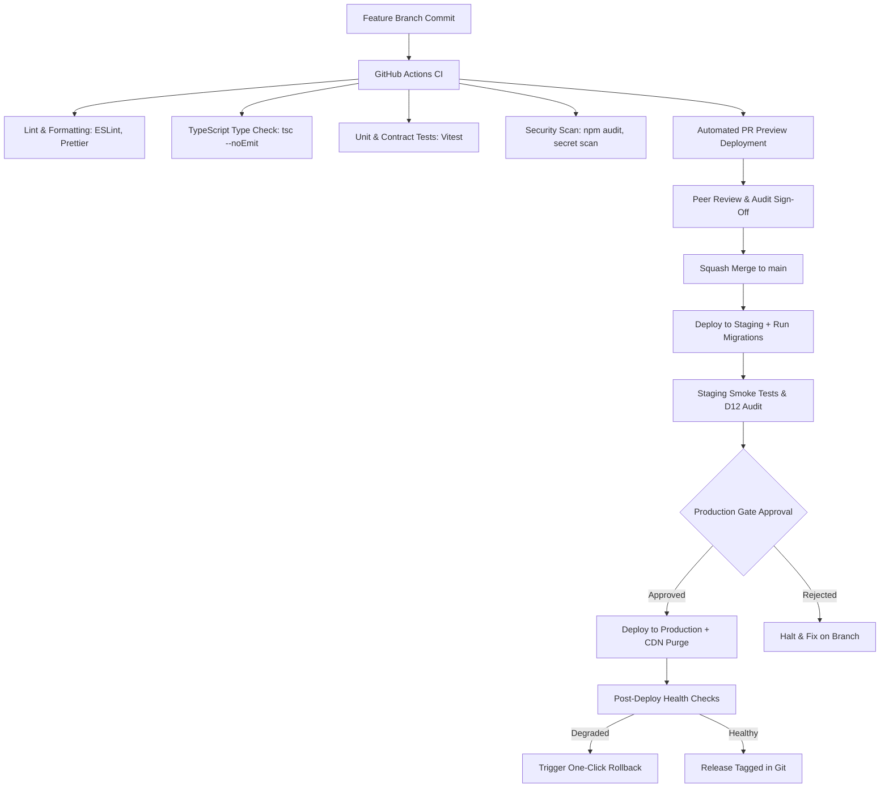

---
doc_id: D13
title: Deployment Pipeline and Release Operations
file: DEPLOYMENT_PIPELINE.md
version: 1.0.0
status: Baselined
author: Amr Suleiman (Product & Technical Lead)
reviewer: Lead Software Engineer / Auditor
approved_by: Amr Suleiman & GDGOC ABU Zaria Core Team
approved_on: 2026-11-02
depends_on: [D00@1.0.0, D05@1.0.0, D08@1.0.0, D11@1.0.0]
---

# D13 Deployment Pipeline and Release Operations

Nov 2, 2026 · @Amr Suleiman & Core Engineering Team

## 1. Document control, principles and environments

D13 defines how code reaches users safely: the checks every change passes, the environments it moves through, how releases and rollbacks happen, and what must be true before go-live. Two developers share it, so every step is written down and automated where possible.

| Field | Value |
| --- | --- |
| Document | D13 Deployment Pipeline |
| Version | 1.0.0 (Baselined) |
| Phase and gate | P10 Release; used from BP-01 onward, gate G6 and G7 |
| Inputs | D00, D05 sections 4, 11, 12; D08; D09 section 9; D10; D11; D12 |
| Feeds | D14 (post-launch operations backlog) |

### Principles

- **DEP-01: Automate the boring and risky steps.** Checks, builds, migrations and deployments run from the pipeline, never from a laptop.
- **DEP-02: The same build moves through every environment.** What was tested on staging is what reaches production; only configuration differs.
- **DEP-03: No direct pushes to the main branch.** Every change is a reviewed pull request with passing checks and signed-off gate criteria.
- **DEP-04: Small, frequent, reversible releases.** Every release can be rolled back in minutes, and migrations are written to allow it.
- **DEP-05: Secrets stay in the platform.** None in the repository, the pipeline logs, or chat (D08 SEC-420 to SEC-426).
- **DEP-06: Nothing is real in non-production.** Preview and staging use fake data and a test email sink.

### Environments

| Environment | Created by | Data | Email | Payments data | Who can reach it |
| --- | --- | --- | --- | --- | --- |
| Local | Developer machine | Seed | Console output | Fake | Developer |
| Preview | Each pull request, automatically | Seed copy | Sink | Fake | Developers, protected link |
| Staging | Merge to main | Synthetic, refreshed on demand | Sink | Fake, test bank details | Developers and testers, protected |
| Production | Manual approval after staging checks | Real | Real | Real | Public |

Staging must mirror production in configuration (headers, CSP, cookies, scheduler, storage rules) so a security test there means something (D12 SAR-01). Staging is never indexed by search engines and sits behind HTTP Basic Auth or Vercel Deployment Protection.

---

## 2. Pipeline from commit to production

### Automated CI Checks (Every Pull Request)

Every PR must pass the automated GitHub Actions workflow (`.github/workflows/ci.yml`) before merging:

1. **Linting and Format Enforcement**:
   - `npm run lint` (ESLint strict mode, zero warnings allowed).
   - `npm run format:check` (Prettier validation).
2. **Type Safety Verification**:
   - `npm run type-check` (`tsc --noEmit`, strictly disallowing `any`).
3. **Automated Testing Suite**:
   - `npm run test` (Vitest running unit tests and Zod schema contract tests).
   - Validation that all API endpoints conform to `API_CONTRACT.md` response envelopes.
4. **Dependency & Secret Audit**:
   - `npm audit --audit-level=high` (Zero high/critical CVEs).
   - TruffleHog / GitGuardian scan preventing credential leaks.
5. **Build Artifact Generation**:
   - `npm run build` (Ensures Next.js static generation and compilation succeed).

---

## 3. Branching and gate governance

- **`main`**: Protected branch representing deployable staging/production code. Direct commits and force pushes are blocked.
- **`bp-NN-short-name`**: Phase/build prompt branches (e.g., `bp-07-spotlight-checkout`).
- **Merge Requirements**:
  1. Passing CI status checks.
  2. One approving review from the peer developer/auditor.
  3. Gate sign-off recorded in the PR body referencing the specific prompt (`BP-NN`) and audit check (`AU-NN`).
- **Release Tagging**: Every production release is tagged with semantic versioning (`v1.0.0`, `v1.0.1`).

---

## 4. Database migrations and zero-downtime execution

Migrations use Prisma / Drizzle ORM with strict version control in `prisma/migrations` or `drizzle/migrations`.

### The Expand-and-Contract Migration Rule
To prevent downtime when app code and database schema transition:
1. **Expand**: Add new columns as nullable or with defaults. Never drop or rename active columns in the same step.
2. **Deploy Code**: Deploy the application version that writes to both old and new fields, but reads from the new field.
3. **Contract**: In a subsequent migration, drop or archive the obsolete column after verifying zero active reads.

### Migration Execution Procedure
- **Staging**: Migrations run automatically during deployment via `npx prisma migrate deploy` or equivalent.
- **Production**:
  1. An automated snapshot backup of the production database is taken immediately before migration.
  2. Migration runs in an isolated transaction.
  3. If migration fails, transaction rolls back automatically, the deployment halts, and an alert is sent.

---

## 5. Staging verification and pre-release checklist

Before approving promotion from Staging to Production, the team must execute the **Staging Verification Checklist**:

- [ ] **Health Endpoint**: `GET /api/health` returns `{"status": "ok", "db": "connected", "redis": "connected"}`.
- [ ] **Public Core Smoke Test**:
  - Homepage loads within 1.5 seconds on 3G simulation.
  - Search returns filtered results across Communities, Events, and Opportunities.
  - Community Profile renders and "Join" button directs to valid external URL.
- [ ] **Submission Smoke Test**:
  - Submitting a test club generates a `CY-XXXX-XXXX` tracking code.
  - Tracking page displays `Pending` status.
- [ ] **Admin Smoke Test**:
  - Admin login functions with MFA.
  - Test submission appears in review inbox.
  - Approving moves listing to public directory; Rejecting sends recorded reason.
- [ ] **Spotlight Payment Smoke Test**:
  - Creating a listing produces an `SP-XXXX-XXXX` reference.
  - Test receipt upload saves to private storage with signed 5-minute URL.
  - Admin payment confirmation activates listing and starts expiry timer.
- [ ] **Security Verification**:
  - HTTP headers return `Content-Security-Policy`, `X-Content-Type-Options: nosniff`, `Strict-Transport-Security`, `X-Frame-Options: DENY`.
  - Evidence receipts return `403 Forbidden` on direct public access.

---

## 6. Production release, rollback procedures and incident response

### Release Steps
1. Staging checks pass with zero open Blocker or Major findings.
2. Production promotion is triggered via hosting dashboard (Vercel / Railway / Render).
3. The platform deploys the immutable container/serverless build artifact.
4. Edge CDN cache is purged for updated static pages.
5. Verification of production health check endpoint (`https://Campusly.abu.edu.ng/api/health`).

### Rollback Strategy (DEP-04)
If any critical error, payment issue, or security flaw is discovered post-release:
1. **Instant Application Rollback**:
   - In the hosting control panel, click **Rollback to Previous Deployment**.
   - Rollback takes effect at the CDN edge within 60 seconds without re-building.
2. **Database Rollback**:
   - If a migration was applied, execute the corresponding `down` migration script or restore from the pre-deployment snapshot if data corruption occurred.
3. **Post-Rollback Root Cause Analysis (RCA)**:
   - File an incident report within 24 hours.
   - Author a Change Request (`CR-###`) before re-attempting release.

---

## 7. Backups, observability and disaster recovery

### Backup Schedule
- **PostgreSQL**: Automated daily full snapshots with 30-day point-in-time recovery (PITR). Stored in a geographically separate cloud storage region.
- **Object Storage (`evidence` and `public-media`)**: Bucket versioning enabled; deleted objects retained for 30 days before permanent deletion.
- **Weekly Backup Restoration Drill**: Automated job spins up an ephemeral database from the latest snapshot every Sunday, verifies record count integrity, and tears down.

### Disaster Recovery Targets (ARC-1221)
- **Recovery Point Objective (RPO)**: $\le 24\text{ hours}$ (maximum data loss acceptable under catastrophic hardware failure).
- **Recovery Time Objective (RTO)**: $\le 8\text{ hours}$ (maximum time to full platform availability).

### Observability & Alerting
- **Error Tracking**: Sentry integrated on client and server, reporting unhandled exceptions with request IDs.
- **Log Aggregation**: Structured JSON logs streaming to Axiom / Better Stack; all PII, tokens, and passwords masked.
- **Threshold Alerts**: Push notifications to both developers via email/Telegram for:
  - Unhandled 500 error rate exceeding 1% over 5 minutes.
  - Database connection pool exhaustion (>85% utilization).
  - Failed scheduled cron jobs (`expire-spotlight`, `rotate-featured`).

---

## 8. Secrets and environment management

| Variable | Environment | Description | Storage |
| --- | --- | --- | --- |
| `DATABASE_URL` | All | Postgres connection string with SSL | Hosting platform secrets |
| `REDIS_URL` | All | Redis connection string for rate limits | Hosting platform secrets |
| `STORAGE_ACCESS_KEY` | All | S3/R2 storage access credentials | Hosting platform secrets |
| `STORAGE_SECRET_KEY` | All | S3/R2 storage secret key | Hosting platform secrets |
| `ADMIN_JWT_SECRET` | Staging, Prod | Cryptographic key for admin session cookies | Hosting platform secrets |
| `CRON_SECRET` | Staging, Prod | Bearer token for scheduled job triggers | Hosting platform secrets |
| `NEXT_PUBLIC_CAMPUS` | All | Default campus slug (`abu-zaria`) | Build environment config |

- Real credentials are never stored in git or `.env` committed files.
- `.env.example` provides documentation for required keys with dummy values.
- Keys are rotated every 90 days or immediately following any developer offboarding.

---

## 9. Traceability and change log

| ID | Description | Cross-Reference |
| --- | --- | --- |
| DEP-01 | Fully automated CI/CD pipeline | Architecture ARC-C1, Prompt P10 |
| DEP-02 | Immutable artifact promotion | Architecture ARC-1201 |
| DEP-03 | Branch protection & 2-person review | Document Map D00, Roles |
| DEP-04 | 60-second one-click rollback | Security SEC-602 |
| DEP-05 | Secrets platform isolation | Security SEC-420–SEC-426 |
| DEP-06 | Synthetic non-production data | Legal D09 Section 9, NDPA |

### Change log

| Version | Date | Author | Change |
| --- | --- | --- | --- |
| 0.1.0 | 2026-11-02 | Amr Suleiman | Initial draft (stub). |
| 1.0.0 | 2026-11-02 | Amr Suleiman & Lead Software Engineer | Complete production-ready specification: CI/CD automation, expand-and-contract migrations, staging checklist, instant rollback, backup drills, and observability. Baselined at Gate G6. |

